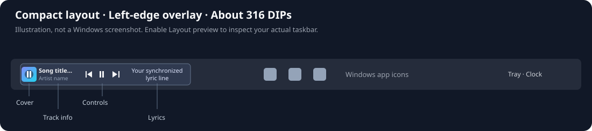

# Taskbar Fluent Media + Lyrics 3.0.6

Restores album art, track details and media controls alongside synchronized Roman-script lyrics in the supplied Windhawk mod. The original file explicitly disabled the full player, ignored its visibility switches and compiled out its UI.

**Configurable double-clicks in 3.0.6:** under **Main Settings → Media player**, choose **Double-click target** (Off, Lyrics, Album artwork, or both), then **Double-click action** (Open music app, Open expanded player, or Play / pause). Off is the default and preserves normal clicks. Lyrics work in full-player and lyrics-only modes. For the native cover playback button, a single click waits for Windows' double-click interval when artwork double-clicks are enabled; two close clicks run only the chosen double action. Fast clicks far apart remain separate singles. Timers run only while a cover click is pending and are canceled on settings changes, UI removal and taskbar restart. If the cover playback button is off, selecting artwork overrides its legacy click mappings with the selected double-click action.

**Artwork playback button in 3.0.5:** a centered play/pause button is enabled on the cover by default, using no extra taskbar width. It shows Pause while playing and Play while paused, supports keyboard/touch activation, and disables when the session cannot toggle playback. Toggle **Main Settings → Album Art → Play/pause button on cover** to restore custom artwork clicks and the legacy paused indicator. Overlay icon size/background opacity use the existing artwork display settings. The separate control row remains configurable.

**Compact layout in 3.0.4:** enabled by default, including upgrades. The usual cover, title/artist, three buttons and lyrics occupy at most about **316 DIPs**, compared with roughly 500 before. Track names truncate with an ellipsis; lyrics keep the existing wrapping option. No controls are removed. Smaller custom sizes still work. Disable **Main Settings → Media player → Compact horizontal layout** to restore larger custom sizes and whole-player width limits. Additional buttons or the optional visualizer need extra space.

**Settings-save crash fix in 3.0.3:** the previous callback requested a full DLL unload/reload on every settings save. XAML callbacks can outlive removal of their UI tree, making that policy unsafe. Settings now apply in place: pause admission of new jobs, stop producers, drain workers (including captured-resource destruction), read settings and rebuild the UI on the taskbar thread, then resume. The settings callback explicitly requests **no DLL reload**. The live XAML root is reused for edits on the same taskbar.

If upgrading from a crashing version, disable it, compile this source while disabled, restart Explorer once to discard the old DLL/callbacks, then enable 3.0.6. Restart TranslucentTB afterward if necessary. Ordinary settings changes in 3.0.3 do not request an Explorer restart or module reload. Runtime confirmation on Windows is still required; the cloud tests below do not run Explorer.



## Install on Windows

1. Open the existing mod in Windhawk's source editor. Replace its source with **[taskbar-fluent-lyrics.wh.cpp](taskbar-fluent-lyrics.wh.cpp)**, then compile and enable it. Disable any separate copy of the original player to prevent duplicate taskbar injection. The mod ID is preserved for replacement.
2. In **Main Settings → Media player**, select **Media player and lyrics** and **Taskbar – Left edge (Overlay)**, the new default. This places the player in the leftmost free taskbar space. On a crowded or left-aligned taskbar, a complete player may not fit; reduce its width/components or select a tray placement. Turn on **Show album art**, **Show track title**, **Show artist name**, **Show media buttons**, and **Show synchronized lyrics** if the previous version saved them as off. New installations enable them by default.
3. Turn on **Layout preview** to see sample text, a cover placeholder, controls and lyrics without a media app. **Show debug borders** outlines the individual areas. Turn preview off after arranging them.
4. Start a music app that exposes a Windows media session. The cover comes from that app; missing artwork shows the configured placeholder. Previous/play/next, seek, shuffle and repeat depend on the capabilities the app exposes. Disabled buttons indicate unavailable actions.

At the left edge, the default component order is **cover → title/artist → previous/play/next → lyrics**, followed by the native taskbar buttons. Cover and controls have independent side selectors; mirror layout changes their automatic sides. Lyrics can be placed on either side of the whole player.

## Position and size controls

- Whole-player X/Y offsets, fixed width/height, square cover size, lyric width/font/timing/offsets, title/artist fonts, button sizes and opacity have bounded number settings.
- **44 settings** declare native slider metadata with a number input beside it on Windhawk 2.x builds that support `$format: slider`. Windhawk **1.7.3 uses number inputs**; mods cannot add native rails to that version's editor. The new annotations use forward-compatible comments so 1.7.3 can still read the settings.
- With compact layout off, a zero width means fit content, respecting the older min/max text fields. A zero cover size or player height uses their older min/max fields. Nonzero simple-size settings take precedence over those legacy pairs. If you make the whole player narrower than all its content, reduce lyric/text/cover/button sizes too.
- All dimensions are DIPs, so a 32-DIP cover is 48 physical pixels at 150% scaling. Monitor numbering follows Windows monitor enumeration, which can differ from Display Settings.
- Tray positions support both the older **Grid** and newer **StackPanel** taskbar templates. Grid insertion/removal preserves neighboring columns and spans.
- Taskbar positions share one overlay placement routine. It avoids recognized taskbar controls and searches for free space on the requested side of an anchor. Center selects the nearest available slot. Lyrics-only mode can narrow; the full player hides if no slot fits its controls. It never moves or shrinks Windows' app buttons. A hidden/missing configured anchor falls back to the left of the tray, with a log message. If a displayed anchor later disappears, the overlay hides until it returns; change placement to move it immediately.
- Start with tray placement on a crowded or left-aligned taskbar. Taskbar overlays cannot create free screen space. Whole-player offsets in tray placement are manual visual adjustments; leave them at zero for a normal reserved slot.

## Changes affecting power and reliability

- Explorer UI dispatch catches and logs C++/WinRT exceptions, uses a module-specific message identity, and reports callback failure. Partial media-event subscriptions are rolled back, each removal is attempted independently, and session changes defer scroll-state resets to the UI thread. TranslucentTB compatibility still requires a Windows runtime test; the reported Explorer error has not been reproduced here.
- Startup retries are canceled before removing the UI or unloading the module; initialization exceptions are logged with HRESULT codes. The optional success notification now writes a log entry instead of opening a modal Windows dialog. These fixes do not identify an unspecified Windows error popup.
- The full interface is compiled and the component visibility switches are honored. Lyrics remain optional rather than disabling the player.
- Lyric cue updates refresh only the lyric visual, avoiding full-player tree walks, cover copies and artwork decoding on every line.
- Media-properties requests are coalesced. Superseded requests and previous-session updates cannot commit metadata over a newly selected session.
- Cover analysis scales images to at most 256×256 before allocating pixels; visible cover decoding is capped at 512 pixels. Medium/high settings account for DPI. Button readiness handlers are removed after use and key hover handlers use weak references.
- Reused album art is accepted across tracks. The former browser heuristic could hide a valid cover indefinitely.
- Timeline snapshots are cached for up to one second and interpolated at the lyric cadence. Playback/seek events invalidate the cache; playback speed is respected. Seek buttons also use the estimated live position rather than an old timeline timestamp.
- Paused/absent media uses a one-second wait. Idle hiding measures elapsed time rather than counting event/timer wakes. Visibility checks do not force a layout every poll.
- Battery/Windows energy-saver mode uses a minimum 200-ms lyric interval, removes lyric transitions, stops the optional audio visualizer and pauses text scrolling. Text scrolling and visualizer default to off. Power state is checked every five seconds.
- Lyrics use a bounded 32-track positive cache, response/cue limits and a maximum of three lookup attempts for an unchanged track. Metadata changes or a settings update start a new attempt budget. Lyrics lookups stop issuing requests while settings apply.
- Settings saves keep the DLL loaded. A serialized pause/stop/drain/UI-reconfigure/resume sequence protects settings from concurrent readers. New media callbacks cannot start jobs while settings apply, and captured COM resources are destroyed before a job is counted as drained. Failed reads restore the previous configuration and resume producers.
- Media buttons have accessible names, tooltips and session capability checks. An explicit empty button list stays empty.

Online lyrics send title and artist to `lrclib.net` using HTTPS. Disable **Fetch synced lyrics online** to stop those lookups. No credential is required. English lyrics remain unchanged, including punctuation and emoji. Hindi always uses Roman letters (Hinglish). Approximate Hindi/Gurmukhi romanization runs locally; it does not translate lyrics. No lyrics service has complete catalog coverage, and some media apps do not expose usable timelines.

## Development and validation

The cloud checkout originally had no project files or commits. This source comes from the uploaded `tb music.txt`; it was not fetched from a populated remote branch. No changes have been pushed.

On Linux x64, prepare the optional, pinned cross-compiler outside the checkout and run:

```sh
python3 -m pip install -r requirements-dev.txt
python3 tools/bootstrap.py
python3 tools/test.py --mutation-check
python3 tools/test.py --sanitize
python3 tools/build.py --arch x86_64 --arch aarch64
```

The bootstrap checks SHA-256 hashes of the LLVM-MinGW toolchain, Windhawk 1.7.3 headers/import libraries, Windows SDK C++/WinRT projection and archive extractor. It preserves TLS verification and leaves external SDK headers unchanged. The case-insensitive compiler overlay reproduces Windows include lookup on Linux. It uses only the existing checkout; a worktree is unnecessary.

The DLLs in `build/` are for compiler validation. Install the `.wh.cpp` through Windhawk so it builds with its own runtime, architecture and mod identity. Do not manually inject the cross-built DLL into Explorer.

| Check | Result |
| --- | --- |
| Pure production C++ placement, LRC parsing and romanization | 26 scenarios passed |
| Randomized placement bounds and collision invariants | 10,000 passed |
| Windhawk settings defaults, bindings, dropdowns and slider bounds | 161 bindings / 44 sliders checked |
| Live settings lifecycle, failure recovery and worker drain | 1,000 callback saves / 100 concurrent-worker cycles passed |
| Old forced-reload policy mutation | Rejected by the regression test |
| Address / undefined-behavior sanitizers on C++ regression harness | Passed |
| Production cover click classification | Single/double/triple, timing/distance bounds and 1,000 rapid clicks passed |
| Compact preset, saved-size caps, custom opt-out and free-space fit | Passed |
| Full x64 Windows compile and link | Passed |
| Full ARM64 Windows compile and link | Passed |
| Explorer rendering, clicks, music-app integration, monitor/DPI changes | Requires Windows verification |
| Measured CPU/battery improvement | Not measured on this Linux machine |

See **[Windows validation checklist](docs/validation.md)** for the remaining checks. Compilation and geometry tests cannot prove compatibility with every Windows private taskbar template or music app. This revision is prepared for Windows testing, not a claim of zero bugs.
